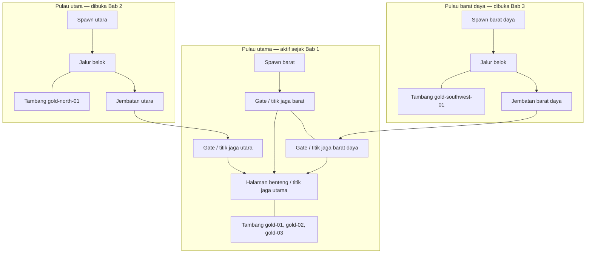
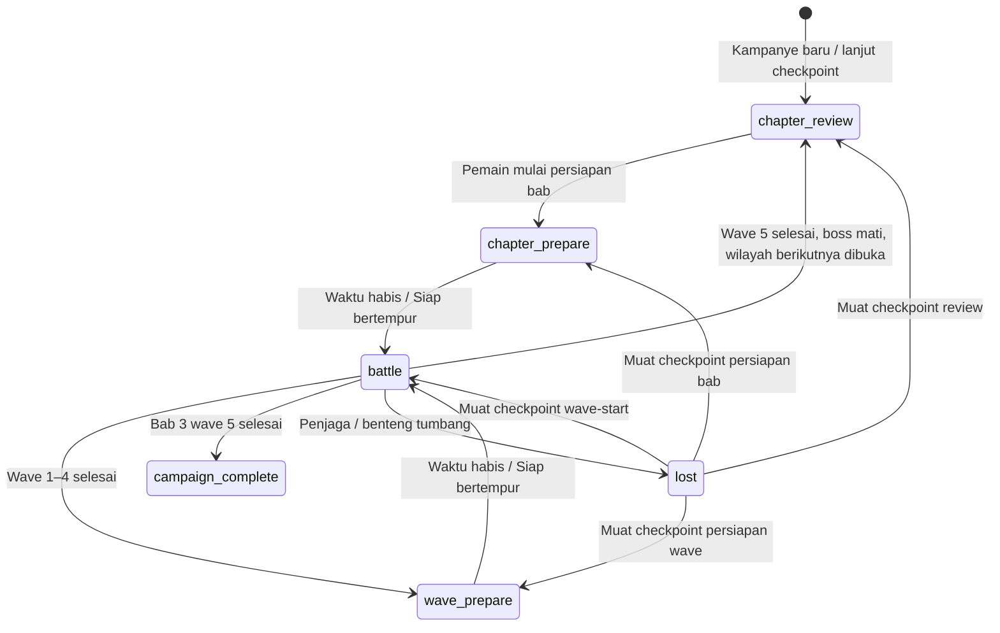

# Rancangan kampanye Penjaga Pulau — Tahap 1

Baseline audit adalah `6312d36` pada repo `Penjaga Pulau`. Rancangan ini disimpan di branch `codex/campaign-design`. Tahap berikutnya mengimplementasikan spesifikasi dalam [campaign-contract.md](campaign-contract.md). Tahap ini menambahkan dua dokumen, dengan prioritas desktop, keyboard, dan mouse.

## 1. Hasil audit kode terbaru

| Bagian yang diperiksa | Sistem tersedia | Dampak untuk kampanye |
| --- | --- | --- |
| [game.js](../game.js), [src/runtime.js](../src/runtime.js) | Membuat runtime baru saat beralih dari `island` ke `crossroads`. Runtime sebelumnya melepas input, renderer, audio dan frame | Buat satu runtime untuk dunia kampanye. Pergantian bab memperbarui progres dan topologi aktif |
| [src/expedition.js](../src/expedition.js) | Dua arena berurutan, hasil ditolak bila identitas arena sudah kedaluwarsa. Carry hanya emas dan enam rank. HP dihitung ulang hingga penuh | Pakai kembali aturan penolakan hasil kedaluwarsa. Kebijakan bab perlu membawa seluruh kondisi yang ditetapkan di bagian 5 |
| [src/session.js](../src/session.js), [src/lifecycle.js](../src/lifecycle.js) | Reset mengosongkan pasukan, resource, rank dan cooldown | Pisahkan mulai kampanye baru, mulai gelombang, pergantian bab dan pemulihan checkpoint |
| [src/director.js](../src/director.js) | Roster seeded, kelompok spawn, estimasi waktu tempuh, keberangkatan berdasarkan target kedatangan | Pakai kembali penjadwal. Masukan jalur aktif harus berasal dari bab. Hapus asumsi khusus gelombang kedua dan pengelompokan dua arah |
| [src/world/world.js](../src/world/world.js), [maps/validate-map.js](../maps/validate-map.js) | Registry beberapa jalur, waypoint per unit, satu spawn boss. Definisi disalin ke World | Geometri baru memerlukan daratan terpisah, jembatan, aktivasi wilayah, dan pemilihan jalur boss per bab |
| [src/navigation.js](../src/navigation.js) | Satu rentang kolom per baris pada `rows`, grid navigasi 32 px, connected components dan cache rute bersama | Representasikan union beberapa pulau dan jembatan. Bangun ulang topologi setelah unlock |
| [src/renderer.js](../src/renderer.js) | Skala vertikal mengikuti tinggi seluruh world. `cameraY` selalu nol, kamera hanya mengikuti X | Pisahkan ukuran world dan viewport. Kamera perlu mengikuti X/Y agar pulau baru tetap terbaca |
| [src/config.js](../src/config.js), [src/upgrading.js](../src/upgrading.js) | Lima wave, enam ID upgrade, rank maksimum 10, bonus pada 5 dan 10. Harga masih memakai rumus inline | Pertahankan ID dan milestone, tambahkan tier berdasarkan bab dan tabel biaya dari Chat 2 |
| [src/combat.js](../src/combat.js), [src/boss.js](../src/boss.js) | Dash, perfect dodge, riposte, dan boss dengan tiga pola sudah ada. Boss masih memeriksa `waveIndex === 4` | Kontrak skill dimulai dari kemampuan yang ada. Boss dibaca dari wave definition setiap bab |
| [src/economy.js](../src/economy.js) | Menambang dengan tahan E. Tambang tidak habis. Penduduk memberi resource setiap enam detik | Tentukan budget tambang per bab dan pindahkan reward ke profile ekonomi. Audit parameter mining aktual di bawah |
| [src/ai.js](../src/ai.js), [src/input.js](../src/input.js) | F mengikuti penjaga, G menjaga `world.squadGuard`, formasi dan leash. WASD/panah, Spasi/klik, Shift, E, U, 1, 2, Q, P/Esc | Pertahankan kontrol dasar. Titik jaga tambahan dipilih melalui HUD mouse, lalu G menerapkan perintah ke titik terpilih |
| [src/menu.js](../src/menu.js), [src/ui.js](../src/ui.js), [src/inspection.js](../src/inspection.js) | Menu utama/persiapan, camp, HUD dan snapshot diagnostik. Skor terbaik/audio tersimpan, progres ekspedisi hanya di memori | Tambahkan UI tiga bab, arah aktif dan checkpoint. Snapshot perlu identitas bab/wave serta jadwal kedatangan |
| [tests/menu-browser-test.mjs](../tests/menu-browser-test.mjs) | Uji menu dengan keyboard/touch dan hasil ekspedisi melalui hook DevTools | Jadikan dasar uji menu desktop dan transisi bab. Suite traversal, save dan progres kampanye perlu ditambahkan pada implementasi |

Nilai manual terakhir `GATHERING_REWARDS.gold` di baseline adalah **10000**. Tahap ini tidak mengubahnya atau menjadikannya angka keseimbangan kampanye. Profile kampanye baru hanya boleh aktif setelah parameter Chat 2 terisi dan tervalidasi. Label hadiah tetap membaca sumber yang sama dengan transaksi resource.

## 2. Keputusan struktur kampanye

- Satu kampanye memuat tiga bab, masing-masing lima wave. UI menampilkan bab dan wave lokal, misalnya “Bab 2 · Gelombang 3/5”. Nomor global 1–15 diturunkan dari urutan bab.
- Benteng, pulau utama dan koordinatnya berada pada world yang sama sepanjang kampanye. Pulau utara dan barat daya terlihat terkunci, kemudian dibuka setelah bab sebelumnya selesai.
- Bab 1 memakai `path-west`. Bab 2 menambah `path-north`. Bab 3 menambah `path-southwest`. Dua jalur pertama mempertahankan ID prototipe untuk memudahkan adaptasi.
- Setiap wave kelima memiliki satu boss. Rancangan awal memakai ulang archetype Panglima dan pola combat yang sudah tersedia, dengan profile per bab. Pembuatan tiga boss unik memerlukan keputusan konten tersendiri.
- Selesainya bab mensyaratkan seluruh jatah spawn sudah diluncurkan, boss mati, musuh tersisa nol, dan penjaga serta benteng masih hidup. Boss mati lebih awal belum membuka wilayah.
- Mode “Latihan Map 2” lama digantikan oleh susunan kampanye saat implementasi diterima. Logika multi-jalur tetap dipakai. URL lama `?map=crossroads` diarahkan ke persiapan kampanye, tanpa melewati unlock.
- Enam ID upgrade dan bonus existing pada rank 5/10 dipertahankan. Baseline membatasi rank pada 10. Kontrak memparameterkan cap tier dan maksimum kampanye agar keputusan progres dapat masuk tanpa mengganti ID. Rank di atas 10 memerlukan adapter stat baru; menaikkan cap saja tidak cukup.

| Bab | Wilayah yang dapat dijelajahi | Arah aktif | Setelah kemenangan |
| --- | --- | --- | --- |
| `chapter-1` | `island-main` | Barat | Buka `island-north` dan `bridge-north` |
| `chapter-2` | Utama dan utara | Barat, utara | Buka `island-southwest` dan `bridge-southwest` |
| `chapter-3` | Ketiga pulau | Barat, utara, barat daya | Kampanye selesai |

## 3. Denah awal

Denah menunjukkan hubungan ruang, bukan map siap dimainkan. Bentuk pantai mengikuti mask tile saat authoring. Titik berikut memakai koordinat world pixel dengan X ke kanan dan Y ke bawah.

### Ukuran dan hubungan koordinat

Usulan world adalah **2560 × 1792 px**, tile **64 px**. Pulau utama memakai geometri `island` saat ini dengan translasi **(+768, +640)**. Translasi diterapkan pada seluruh titik, collider, origin domba, resource, dekorasi dan waypoint sekaligus. Benteng tidak berpindah lagi antarbab.

| Elemen | ID | Posisi / rute referensi |
| --- | --- | --- |
| Pulau utama | `island-main` | Mask `island` lama dengan origin `(768,640)`. Batas daratan efektif sekitar X 848–1963, Y 720–1270 |
| Benteng | `blue-fortress`, sumber `building-01` | Target combat `(1613,950)`. Collider bangunan mengikuti sumber yang ditranslasi |
| Awal penjaga | `hero-start` | `(1556,1010)` |
| Jaga benteng | `guard-castle` | `(1613,995)` |
| Gate / jaga barat | `gate-west` / `guard-west` | `(1433,1035)`, area pertempuran di jalan menuju halaman |
| Gate / jaga utara | `gate-north` / `guard-north` | `(1533,965)`, area pertempuran di halaman utara |
| Gate / jaga barat daya | `gate-southwest` / `guard-southwest` | `(1198,1120)`, area pertempuran di sisi barat daya pulau utama |
| Pulau utara | `island-north` | Amplop authoring X 1408–2048, Y 64–576. Pantai dan obstacle perlu digambar |
| Jembatan utara | `bridge-north` | Garis tengah `(1568,512) → (1568,800)`, lebar awal 128 px |
| Pulau barat daya | `island-southwest` | Amplop authoring X 192–768, Y 1152–1728 |
| Jembatan barat daya | `bridge-southwest` | `(704,1312) → (832,1312) → (832,1184) → (960,1184)`, lebar awal 128 px |
| Tambang utama | `gold-01`, `gold-02`, `gold-03` | Sumber lama setelah translasi, sekitar `(1339,1174)`, `(1378,1203)`, `(1414,1171)` |
| Tambang utara | `gold-north-01` | Sekitar `(1808,352)`, di sisi jalur utara dengan tempat berdiri bebas collider |
| Tambang barat daya | `gold-southwest-01` | Sekitar `(384,1536)`, menyimpang dari jalan utama sehingga perlu keputusan waktu perjalanan |

Lebar jembatan 128 px adalah ukuran prototipe untuk beberapa unit melewati grid 32 px. Ujung jembatan harus menumpang pada daratan dan ruang putar tetap lebih lebar daripada footprint unit. Renderer dan navigasi memakai geometri lantai yang sama. Lantai tidak menjadi cover proyektil; hanya obstacle eksplisit yang menghalangi panah. Jembatan tidak dapat dihancurkan pada rancangan awal.

Gate barat, utara, barat daya dan awal penjaga telah diperiksa terhadap `positionFits` map sumber sebelum translasi. Hasilnya valid untuk titik nominal. Bentuk pulau baru, seluruh lane, jalur antartitik, dan lebar jembatan belum disimulasikan.

### Jalur serangan dan perpindahan

| Jalur | Waypoint referensi |
| --- | --- |
| `path-west` | `(878,1045) → (999,1042) → (1118,1033) → (1278,1050) → (1433,1035)` |
| `path-north` | `(1664,128) → (1664,384) → (1568,512) → (1568,800) → (1536,896) → (1533,965)` |
| `path-southwest` | `(256,1600) → (448,1472) → (704,1312) → (832,1312) → (832,1184) → (960,1184) → (1198,1120)` |

Musuh memakai waypoint sampai gate, kemudian AI combat mencari penjaga, sekutu atau benteng. Gate berada di pulau utama. Titik jaga barat daya berada di luar leash lama terhadap benteng, sehingga AI perlu memakai titik jaga terpilih sebagai anchor.

Pemain dapat memakai jembatan dalam dua arah setelah wilayah terbuka. Jalur kembali dari tambang menuju pertahanan harus ditandai secara visual. Selama battle, benteng tetap bisa diserang ketika pemain pergi menambang. HUD menunjukkan arah aktif, waktu perkiraan kedatangan berikutnya, dan kondisi benteng walau keluar kamera. Warning memakai ikon, label arah dan ETA, dengan penunjuk gate di tepi viewport ketika gate tidak terlihat. Tiga warning memiliki tempat masing-masing agar tidak saling menggantikan. Kamera mengikuti penjaga pada X/Y dengan ukuran area pandang terpisah dari ukuran world; membuka pulau tidak memperkecil seluruh medan.

Sebagai ukuran sketsa, kecepatan jalan dasar saat ini 185 px/detik. Rute dari awal penjaga ke tambang utara melalui jembatan sekitar 4,4 detik satu arah dan ke tambang barat daya sekitar 7,5 detik, sebelum obstacle, pertarungan dan waktu menambang. Itu perkiraan panjang polyline, bukan hasil playtest. Chat 2 memasukkan kebutuhan perjalanan pulang-pergi dan margin keputusan ke parameter persiapan.

## 4. Alur bab dan fase

| Fase kampanye | Perilaku |
| --- | --- |
| `chapter-review` | Dunia dibekukan. Tampilkan hasil bab sebelumnya, wilayah baru, arah tambahan, tier dan budget tambang. Pembelian dapat dilakukan lewat panel. Pemain menentukan kapan persiapan dimulai |
| `chapter-prepare` | Dunia berjalan tanpa musuh. Pemain menjelajah, menambang, memperbaiki dan mengatur pasukan. Waktu memakai parameter `timing.chapterPreparationSeconds.<chapterId>`. Tombol siap dapat mengakhirinya lebih cepat |
| `battle` | Jadwal spawn, combat, cooldown dan resource berjalan. Pembelian upgrade mengikuti pembatasan camp lama. Mining dan tindakan ekonomi yang sudah bisa dilakukan saat battle tetap tersedia |
| `wave-prepare` | Setelah wave 1–4, gunakan `timing.wavePreparationSeconds`. Panel camp menghentikan waktu seperti saat ini |
| `lost` | Simulasi berhenti. Pilihan coba lagi memakai checkpoint terakhir atau mulai kampanye baru |
| `campaign-complete` | Hasil akhir kampanye disimpan. Menu dapat memulai kampanye baru |

Pause, blur, dan dialog menghentikan seluruh jam simulasi, termasuk timer persiapan, mining, cooldown, dan warning. Jam wall-clock tidak memajukan kampanye.

Transisi kemenangan wave 5 dijalankan sekali dengan urutan berikut.

1. Validasi identitas run, chapter, wave dan attempt yang selesai.
2. Terapkan hadiah wave/boss/bab melalui transaksi beridentitas tetap.
3. Catat wave selesai, tentukan cursor bab berikutnya dan tier yang terbuka.
4. Buka pulau dan jembatan berikutnya, bangun ulang mask aktif, obstacle, connected components, cache rute dan terrain.
5. Pertahankan posisi aktor pada daratan yang valid. Hentikan serangan, pekerjaan dan reservasi combat yang sudah kedaluwarsa.
6. Masuk `chapter-review` dan tulis checkpoint. Pada bab terakhir, masuk `campaign-complete`.

Wilayah yang sudah dibuka tetap terbuka sampai kampanye baru. Pulau baru tidak ditutup kembali pada wave berikutnya. Teleport antar-arena dari ekspedisi lama digantikan oleh perjalanan melalui jembatan.

### Pola tekanan yang diusulkan

- Bab 1 mengajarkan satu garis pertahanan dari barat.
- Awal Bab 2 memperkenalkan utara dengan kedatangan bergantian. Wave berikutnya dapat menyelaraskan dua arah.
- Awal Bab 3 memperkenalkan barat daya melalui rotasi arah, kemudian pasangan arah dan akhirnya tiga arah serentak.
- Scheduler mengatur keberangkatan menuju target waktu tiba. Jatah musuh tetap berasal dari wave definition, termasuk ketika jumlahnya tidak habis dibagi dua atau tiga.
- Nilai warning, interval kedatangan dan komposisi musuh diambil dari profile. Hasil Map 2 lama menjadi referensi algoritma, bukan waktu yang dianggap valid untuk jembatan baru.

## 5. Resource, upgrade, skill dan checkpoint

Gold, wood, food, enam rank, HP aktual penjaga/benteng, serta sekutu hidup dibawa antarbab. Peningkatan max HP dihitung dari rank dan profile, bukan dari nilai max HP di save. Pemulihan saat pergantian bab memakai `economy.chapterRecovery.<chapterId>` yang diisi Chat 2. Kebijakan carry ini menggantikan pemulihan penuh dan reset pasukan dari ekspedisi dua arena.

Tier memiliki ID `tier-1`, `tier-2`, `tier-3`, masing-masing tersedia pada bab yang bersesuaian. Ketersediaan karena boss/bab berbeda dari unlock berbayar pada tiap jalur. Cap dan biaya unlock adalah parameter progres. Validasi memerlukan cap yang meningkat dan cap terakhir sama dengan maksimum kampanye pada profile. Bonus existing rank 5/10 tetap diturunkan dari rank, terpisah dari ID tier dan tahap skill. Pembelian sebelum syarat terpenuhi ditolak tanpa mengurangi wallet.

Kontrak skill dimulai dari `dash` dan `riposte` yang sudah ada. Shift mengaktifkan dash, perfect dodge memicu riposte, dan rank `wind`/`counter` tetap menjadi sumber buff-nya. Bentuk kontrak juga mendukung akses dan tahap berdasarkan rank. Skill aktif baru serta hotkey tambahan menunggu kesepakatan konten dan progres.

Tambang direkomendasikan memiliki jumlah panen terbatas per bab. Setiap panen memakai satu charge dan memberikan yield profile yang sama dengan labelnya. Tambang baru aktif bersama wilayahnya. Saat bab berganti, charge diisi ke alokasi bab berikutnya, tanpa penumpukan charge yang belum dipakai. Semua node tergabung dalam satu operasi ekonomi: kuota dibagi antarnode dan produksi otomatis dihitung sekali per operasi. Kontrak mencakup tingkat operasi dan pembeliannya, sesuai usulan Chat 2; ketersediaan dan nominalnya tetap perlu disepakati.

### Sinkronisasi dengan rancangan ekonomi

Dokumen Chat 2 yang sudah tersedia adalah `codex/campaign-economy@cf5d9bc:docs/campaign-economy.md`, juga diaudit dari baseline `6312d36`. Dokumen itu mengusulkan cap 10/20/25, unlock Tier II/III berbayar per jalur, enam konsep skill yang berkembang menurut rank, serta operasi tambang batu → pos → rumah. Ini lebih luas daripada mekanika baseline. Kontrak di dokumen pasangan menyediakan slot data untuk usulan tersebut tanpa menyalin nominal biaya/hadiah.

Usulan itu belum menjadi keputusan gameplay pada branch ini. Sebelum implementasi, sepakati maksimum rank dan efek stat/skill-nya sebagai satu paket; rumus dash existing dapat menghasilkan cooldown negatif bila cap langsung dinaikkan. Carry survivor/HP aktual di rancangan ini juga berbeda dari asumsi reset arena dalam tabel utama Chat 2. Pilih kebijakan carry dahulu, kemudian gunakan perhitungan pembanding Chat 2 dan perbarui anggaran. Parameter persiapan bab harus bisa berbeda per chapter karena jarak perjalanan bertambah.

Checkpoint hanya memotret boundary aman. Sesudah hasil boss, snapshot berada pada `chapter-review`. Saat persiapan dimulai, snapshot berada pada `prepare-start`. Tepat sebelum battle, snapshot `wave-start` menyimpan hasil seluruh pembelian dan pengumpulan selama persiapan. Memuat checkpoint wave-start mengulang wave yang sama dari awal, bukan memberi persiapan baru. Keluar di tengah persiapan mengulang persiapan dari snapshot awalnya beserta resource awal yang sama. Detail idempotensi dan penyimpanan ada di kontrak.

## 6. Modul implementasi dan ketergantungan

| Modul | Perubahan tahap berikutnya | Bergantung pada |
| --- | --- | --- |
| `campaigns/three-islands.js` baru | Definisi tiga bab, wave ID, unlock dan ref profile. Classic script | Kontrak campaign, parameter registry |
| `maps/campaign-islands.js` baru | Geometri tiga pulau, dua jembatan, tiga jalur, gate, titik jaga, tambang | Kontrak geometri v2 |
| `maps/validate-map.js` | Validator union daratan, jembatan dan reachability setiap status unlock | Definisi map, footprint dan lane |
| `src/world/world.js` | Aktivasi wilayah dan versi topologi | Map v2, hasil unlock dari campaign |
| `src/navigation.js` | Query union permukaan, rebuild topologi dan invalidasi rute aktor | World aktif |
| `src/math.js` | Stream seed terpisah, hash ID wave, ekspor/impor state PRNG | Kontrak seed dan checkpoint |
| `src/renderer.js`, `src/assets.js` | Kamera X/Y, viewport tetap, culling pulau, jembatan dan wilayah terkunci | World aktif dan koordinat yang sama dengan navigasi |
| `src/campaign.js` baru | Cursor, receipt hasil, unlock, urutan lima wave per bab. Memakai pola identitas hasil Expedition | Definisi campaign dan transaksi ekonomi |
| `src/session.js`, `src/lifecycle.js` | Pisahkan reset baru, reset wave, transisi bab, restore | Campaign, ekonomi, checkpoint |
| `src/director.js` | Roster per wave ID, daftar jalur aktif per bab, scheduler N arah dan boss terpilih | Campaign context, World, profile combat/timing |
| `src/boss.js`, `src/combat.js`, `src/simulation.js` | Boss dari data, kondisi kemenangan per wave, tick fase baru | Director dan campaign context |
| `src/config.js`, `src/economy.js`, `src/upgrading.js` | Resolver parameter, wallet transaction, biaya, hadiah, tier dan stat turunan | Nilai ekonomi/progres dari Chat 2 |
| `src/mines.js` baru | Charge, yield dan refill epoch. Memakai transaksi wallet di economy | Mine definition, campaign cursor, parameter |
| `src/skills.js` baru | Registrasi dash/riposte dan state cooldown, adapter ke combat | Upgrade ranks dan profile skill |
| `src/ai.js`, `src/input.js` | Anchor titik jaga, follow lintas jembatan, pilihan HUD mouse | Guard point dan graph aktif |
| `src/checkpoint.js` baru | Snapshot boundary, validasi, versi, storage adapter dan restore | Kontrak save, semua serializer state |
| `src/menu.js`, `src/ui.js`, `index.html` | Mulai/lanjut kampanye, bab/wave, status unlock, HUD arah/titik jaga, state penyimpanan | Campaign, checkpoint, parameter label |
| `game.js`, `src/runtime.js` | Satu composition root kampanye dan wiring port. Hapus pergantian arena saat bab berubah | Semua modul di atas |
| `src/expedition.js`, `maps/crossroads.example.js` | Pensiunkan alur arena lama setelah migrasi diterima | Kampanye dan regresi baru |
| `src/inspection.js`, `tests/` | Diagnostik chapter/wave/path, tes deterministik dan boundary | Port campaign, World, checkpoint |

GameSession tetap memiliki wallet, ranks dan aktor runtime. Campaign memiliki cursor serta daftar wave selesai. Definisi map/profile bersifat immutable. Checkpoint adalah proyeksi kedua pemilik state itu, bukan pemilik wallet kedua. Sistem dikomposisikan melalui port agar tidak menjadi satu class kampanye yang menampung combat, rendering dan storage.

## 7. Urutan kerja paralel

1. **Bekukan kontrak ID dan tipe.** Sepakati tiga bab, boundary checkpoint, enam ID upgrade, cap/tier beserta efek stat, serta aturan carry. Chat 2 dapat mengisi registry nilai secara terpisah dari geometri.
2. **Jalankan pekerjaan paralel setelah kontrak dibekukan.**
   - Geometri, World dan navigasi memakai profile fixture yang menyebut ref parameter.
   - Ekonomi/progres mengisi resource, biaya, hadiah, cap tier, charge tambang dan pemulihan.
   - Campaign controller dan checkpoint dikerjakan bersama boundary palsu tanpa renderer.
   - HUD/menu dan kamera memakai snapshot fixture serta denah yang sama.
3. **Integrasikan vertikal Bab 1.** Mulai kampanye, satu jalur, lima wave, boss, transaksi dan checkpoint. Bandingkan mekanika dasar dengan baseline.
4. **Integrasikan unlock utara.** Aktifkan bridge, rebuild graph, checkpoint transisi dan scheduler dua arah. Uji pergerakan dari tambang kembali ke pertahanan.
5. **Integrasikan unlock barat daya.** Generalisasi menjadi tiga arah dan uji kemacetan bridge, distribusi target, warning bertumpuk dan waktu rotasi.
6. **Jalankan kampanye 15 wave serta pemulihan save.** Setelah diterima, ganti menu Map 2 lama dan perbarui URL lama.

Geometri tidak menunggu nominal emas. Penulisan checkpoint menunggu struktur snapshot, bukan angka biaya. Penyetelan tekanan final menunggu geometri yang bisa dilalui, komposisi unit, dan profile hasil Chat 2.

## 8. Kriteria penerimaan dan keputusan yang perlu disepakati

Implementasi perlu membuktikan konektivitas sesuai bab, ketepatan seluruh lane/jitter, serta musuh selalu tiba di pulau utama. Pada seluruh wave, slot spawn unik berjumlah tepat sesuai budget. Tiap bab mempunyai lima wave dan satu boss, dan setiap hasil hanya diterapkan sekali.

Uji boundary mencakup boss mati saat masih ada musuh lain, penjaga/benteng mati pada tick yang sama, hasil lama setelah retry, reload saat persiapan/battle/transisi, serta storage ditolak. Uji desktop mencakup WASD, Spasi/klik, E, Shift, F/G, camp, pause/blur dan kembali dari dialog. Kamera serta warning harus terbaca saat satu atau dua jalur di luar viewport.

Keputusan struktur yang sudah mengikuti permintaan pengguna adalah tiga bab × lima wave, arah bertambah barat → utara → barat daya, dan benteng tetap di pulau utama. Rekomendasi berikut perlu disepakati sebelum implementasi gameplay.

| Topik | Usulan rancangan | Pihak yang perlu menyepakati |
| --- | --- | --- |
| Tier | Cap dari profile. Baseline 10; Chat 2 mengusulkan 10/20/25 dan unlock per jalur. Pertahankan bonus 5/10, pisahkan tahap skill | Pengguna dan Chat 2 memilih paket progres beserta adapter stat |
| Carry | Bawa semua resource, sekutu hidup dan HP aktual. Pemulihan dari profile | Pengguna dan Chat 2 |
| Tambang | Satu operasi bersama, kuota dibagi antarnode, tingkat dan produksi terpisah dari yield manual | Chat 2 dan pemilik gameplay |
| Persiapan | Review bab tanpa batas waktu tetapi dunia beku. Eksplorasi dimulai pada persiapan bertimer | Pengguna dan Chat 2 menentukan durasi |
| Boss/skill | Pakai ulang boss, dash dan riposte dahulu. Konten baru memakai kontrak yang sama | Pengguna menentukan kebutuhan konten berikutnya |
| Titik jaga | Pilih lewat HUD mouse, G menjaga titik terpilih, default di benteng | Pengguna dan pemilik UI/AI |
| Save | Satu slot kampanye lokal, boundary aman, tanpa save tengah combat | Pengguna dan pemilik checkpoint |
| Bentuk dan ukuran | World 2560×1792 dan bridge 128 px sebagai prototipe | Pemilik map dan hasil playtest desktop |

Pemeriksaan Tahap 1 dijalankan lewat Node.js tanpa mengubah runtime.

| Pemeriksaan | Hasil |
| --- | --- |
| Validator map baseline | island dan crossroads valid |
| Posisi sumber untuk hero serta tiga gate | 4/4 titik nominal lolos positionFits |
| Konfigurasi baseline | Enam ID sesuai, max rank 10, mining 10000 |
| Dokumen | 4 contoh JSON dapat di-parse, 23 tautan lokal menuju file yang tersedia |
| Perkiraan panjang rute pemain | Utara 4,36 detik, barat daya 7,54 detik pada 185 px/detik |

Rute tersebut hanya dihitung dari polyline sketsa. Traversal geometri baru, kepadatan tiga arah, save runtime, keadilan ekonomi, dan rasa bermain kampanye belum diuji sebagai gameplay baru. Tes browser gameplay tidak dijalankan pada perubahan dua dokumen ini.
